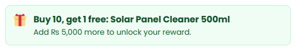
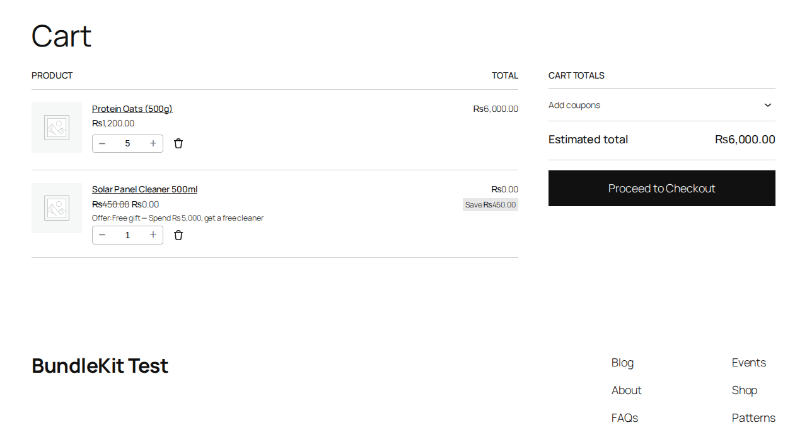
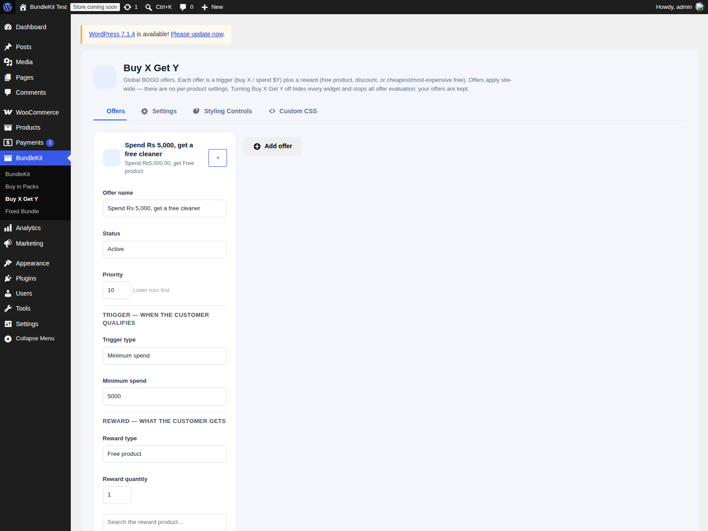

# BundleKit – Buy X Get Y

**BOGO-style global offer rules with a gift picker, auto-added rewards, and cart limits.**

Free and open source. Version 1.0.4.

   

Create global "buy X, get Y" offers that run across your store: buy N products, spend a minimum amount, or buy from selected categories or tags — and customers unlock a free product, a percentage or fixed discount, or the cheapest/most expensive item free. A progress banner tells shoppers how close they are ("Add Rs 5,000 more to unlock your reward").

> There is no separate BundleKit plugin to install. The BundleKit framework is bundled inside this plugin — install and activate just this one.

## Contents

1. [What it is used for](#what-it-is-used-for)
2. [Screenshots](#screenshots)
3. [Features](#features)
4. [Installation and quick start](#installation-and-quick-start)
5. [Creating an offer](#creating-an-offer)
6. [How it works in the cart](#how-it-works-in-the-cart)
7. [Global settings reference](#global-settings-reference)
8. [FAQ and troubleshooting](#faq-and-troubleshooting)
9. [Version history and roadmap](#version-history-and-roadmap)
10. [Support and license](#support-and-license)

## What it is used for

| Use case | How |
|---|---|
| **Clearance** | "Buy 2, cheapest item free" moves slow stock without coupons. |
| **Gift with purchase** | "Spend Rs 5,000, get a free cleaner" with a gift picker. |
| **Category promotions** | "Buy 3 from Beverages, get 10% off" during a campaign week. |
| **VIP spend rewards** | Minimum-spend tiers that reward bigger baskets. |

## Screenshots

**Offer progress banner**: shows the reward and how much more is needed to unlock it.

### Cart reward

**Cart**: the free reward line is added automatically, with the offer name and savings.

### Offers admin

**Offers**: trigger, reward, status, priority and limits — all on one screen.

## Features

**Offers**
- 4 trigger types: Specific products, Product categories, Product tags, Minimum spend.
- 5 reward types: Free product (with variation picker), Percentage discount, Fixed amount off, Cheapest item free, Most expensive item free.
- Offer states: Active, Draft, Scheduled — with priority ordering and per-cart / per-customer limits.

**Cart engine**
- Reward lines are added automatically and keyed to their offer; removed automatically when the cart no longer qualifies.
- Quantity lock on reward lines; no chaining — a reward never triggers another offer.
- Coupon handling is configurable (block or allow); Fixed Bundle lines are excluded; pack lines count toward triggers.
- Guest-safe gift picker — works for logged-out shoppers.

**Admin**
- 4 tabs: Offers, Settings, Styling Controls, Custom CSS.

**Quality**
- No external requests, tracking or telemetry. Nonce checks on settings saves; escaped output.

## Installation and quick start

1. Upload the ZIP at **Plugins > Add New Plugin > Upload Plugin** and activate (WooCommerce must be active).
2. Open **BundleKit > Buy X Get Y > Offers** and add your first offer.
3. Add qualifying products to the cart — the reward line appears automatically.

## Creating an offer

1. **Offers** > add an offer and pick the **trigger type** (Specific products, Product categories, Product tags, or Minimum spend).
2. Set the trigger condition: the products/categories/tags, or the minimum spend amount.
3. Pick the **reward type** and the reward (e.g. the free product and its variation).
4. Set the **status** (Active, Draft, Scheduled), priority and limits, then save.

## How it works in the cart

- When the cart meets an offer's trigger, its reward line is added automatically — marked so it cannot be mistaken for a normal line item.
- If the cart stops qualifying (items removed), the reward line is removed automatically.
- Shoppers cannot change the reward quantity, and rewards never trigger further offers.
- A progress banner can show the unlock message, e.g. "Spend Rs 5,000, get 1 free".

## Global settings reference

| Tab | Controls |
|---|---|
| Offers | Offer list: trigger, reward, status (Active/Draft/Scheduled), priority, per-cart and per-customer limits |
| Settings | Global behavior incl. coupon handling (block/allow) |
| Styling Controls | Banner and offer styling |
| Custom CSS | Your own CSS additions |

## FAQ and troubleshooting

**My offer never triggers.** Check that the trigger type matches the condition: for category offers the Trigger type must be "Product categories" (not "Specific products"). An offer with no products/categories/tags selected can never trigger.

**The category dropdown is empty.** Create categories under **Products > Categories** — categories under Posts don't count.

**The banner text looks broken.** Update to 1.0.4, which fixed the banner rendering for minimum-spend offers.

**I updated the plugin but the old version still seems to run.** Check the version on the Plugins screen. If the files did not actually replace, re-upload the ZIP with "Replace current with uploaded" and restart Apache (to clear OPcache).

## Version history and roadmap

| Version | Highlights |
|---|---|
| **1.0.4** | Minimum-spend banner variants (percent / fixed / cheapest / most expensive) |
| **1.0.1** | Fix: offer product search |
| **1.0.0** | Initial release: global offer rules, gift picker, cart engine |

**Roadmap:** more BundleKit add-ons (Mix-and-match / BYOB, Build-a-box).

## Support and license

Ideas and bug reports: open a GitHub issue, or email **safiqkhan0102@gmail.com**. Author: Shafiqur Rehman.

MIT. See `LICENSE`. (The plugin header also carries `GPLv2 or later` for WordPress.org compatibility.)
